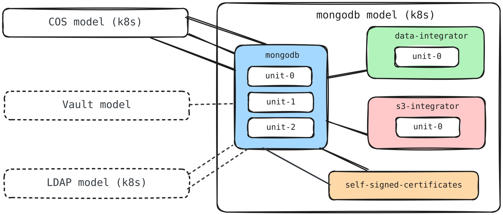

# Charmed MongoDB replica set on AWS Kubernetes

This Terraform root module deploys a Charmed MongoDB replica set with the
`mongodb-k8s` charm on a Kubernetes cluster running on AWS. It uses the
[Terraform Juju provider](https://github.com/juju/terraform-provider-juju/).
For more information, refer to the provider
[documentation](https://registry.terraform.io/providers/juju/juju/latest/docs).

The solution includes a data integrator, TLS certificates, and COS Lite. It can
also integrate with existing LDAP and Vault deployments and deploy an optional
S3 integrator for backups.

## Requirements

| Name          | Version         |
| ------------- | --------------- |
| Terraform     | >= 1.11         |
| Juju provider | >= 2.2.1, < 3.0 |
| Juju          | 3.6 or later    |

The AWS Kubernetes cluster must already be registered as a Juju cloud. By
default, both the MongoDB and COS models use a cloud and credential named
`k8s`. Override `mongodb_model` and `cos` when the registered names differ.

The Juju provider can be configured with `JUJU_CONTROLLER_ADDRESSES`,
`JUJU_USERNAME`, and `JUJU_PASSWORD`.

## Providers

| Name   | Version         |
| ------ | --------------- |
| `juju` | >= 2.2.1, < 3.0 |

## Modules

| Name                       | Source                                                                     |
| -------------------------- | -------------------------------------------------------------------------- |
| `mongodb_replica_set`      | `canonical/mongodb-k8s-operator//terraform/product/replica_set` (`8/edge`) |
| `cos`                      | `canonical/observability-stack//terraform/cos-lite` (`tf-cos-lite-3.0.2`)  |
| `self_signed_certificates` | `canonical/self-signed-certificates-operator//terraform` (`main`)          |

## Resources

| Name                 | Type                                                                                        |
| -------------------- | ------------------------------------------------------------------------------------------- |
| `juju_model.mongodb` | [Juju model](https://registry.terraform.io/providers/juju/juju/latest/docs/resources/model) |

Applications, integrations, offers, secrets, and COS resources are managed by
the child modules listed above.

## Inputs

| Name                                    | Description                                                                                                            | Type                                                                                                                                                                                                                                                                                                                                                                                                                                                                                                                                                                                                                                                                                                        | Default         | Required |
| --------------------------------------- | ---------------------------------------------------------------------------------------------------------------------- | ----------------------------------------------------------------------------------------------------------------------------------------------------------------------------------------------------------------------------------------------------------------------------------------------------------------------------------------------------------------------------------------------------------------------------------------------------------------------------------------------------------------------------------------------------------------------------------------------------------------------------------------------------------------------------------------------------------- | --------------- | :------: |
| `mongodb_model`                         | Kubernetes model configuration for MongoDB.                                                                            | <pre>object({<br/>  name       = optional(string, "mongodb")<br/>  cloud      = optional(string, "k8s")<br/>  credential = optional(string, "k8s")<br/>})</pre>                                                                                                                                                                                                                                                                                                                                                                                                                                                                                                                                             | `{}`            | no       |
| `cos`                                   | COS model and storage configuration. The storage defaults are intended only for testing.                               | <pre>object({<br/>  model_name                    = optional(string, "cos")<br/>  cloud                         = optional(string, "k8s")<br/>  credential                    = optional(string, "k8s")<br/>  risk                          = optional(string, "stable")<br/>  grafana_storage_directives    = optional(map(string), { database = "1G" })<br/>  loki_storage_directives       = optional(map(string), { active-index-directory = "1G", loki-chunks = "1G" })<br/>  prometheus_storage_directives = optional(map(string), { database = "1G" })<br/>})</pre>                                                                                                                                  | `{}`            | no       |
| `mongodb`                               | MongoDB replica-set application configuration.                                                                         | <pre>object({<br/>  app_name    = optional(string, "mongodb-k8s")<br/>  base        = optional(string, "ubuntu@24.04")<br/>  channel     = optional(string, "8/stable")<br/>  config      = optional(map(string), { role = "replication" })<br/>  constraints = optional(string, "arch=amd64")<br/>  expose      = optional(list(object({<br/>    cidrs     = optional(string)<br/>    endpoints = optional(string)<br/>  })), [])<br/>  revision           = optional(number, null)<br/>  storage_directives = optional(map(string), {})<br/>  units              = optional(number, 3)<br/>})</pre>                                                                                                       | `{}`            | no       |
| `data_integrator`                       | Data-integrator application configuration.                                                                             | <pre>object({<br/>  app_name           = optional(string, "data-integrator")<br/>  base               = optional(string, "ubuntu@24.04")<br/>  channel            = optional(string, "latest/stable")<br/>  config             = optional(map(string), { database-name = "mongodb", extra-user-roles = "admin" })<br/>  constraints        = optional(string, "arch=amd64")<br/>  endpoint_bindings  = optional(set(object({ space = string, endpoint = optional(string) })), [])<br/>  machines           = optional(set(string), null)<br/>  revision           = optional(number, null)<br/>  storage_directives = optional(map(string), {})<br/>  units              = optional(number, 1)<br/>})</pre> | `{}`            | no       |
| `s3_integrator`                         | Optional S3 backup-integrator configuration.                                                                           | <pre>object({<br/>  base        = optional(string, "ubuntu@24.04")<br/>  channel     = optional(string, "2/stable")<br/>  config      = map(string)<br/>  constraints = optional(string, "arch=amd64")<br/>  machines    = optional(set(string), [])<br/>  revision    = optional(number, null)<br/>})</pre>                                                                                                                                                                                                                                                                                                                                                                                                | `null`          | no       |
| `self_signed_certificates`              | Self-signed certificate provider configuration.                                                                        | <pre>object({<br/>  app_name    = optional(string, "self-signed-certificates")<br/>  base        = optional(string, "ubuntu@24.04")<br/>  channel     = optional(string, "1/stable")<br/>  config      = optional(map(string), { ca-common-name = "MongoDB CA" })<br/>  constraints = optional(string, "arch=amd64")<br/>  revision    = optional(number, null)<br/>  units       = optional(number, 1)<br/>})</pre>                                                                                                                                                                                                                                                                                        | `{}`            | no       |
| `s3_access_key`                         | Optional AWS S3 access key.                                                                                            | `string` (sensitive, ephemeral)                                                                                                                                                                                                                                                                                                                                                                                                                                                                                                                                                                                                                                                                             | `null`          | no       |
| `s3_secret_key`                         | Optional AWS S3 secret key.                                                                                            | `string` (sensitive, ephemeral)                                                                                                                                                                                                                                                                                                                                                                                                                                                                                                                                                                                                                                                                             | `null`          | no       |
| `tls_client_private_key`                | Optional PEM private key for MongoDB client-to-server TLS certificates.                                                | `string` (sensitive, ephemeral)                                                                                                                                                                                                                                                                                                                                                                                                                                                                                                                                                                                                                                                                             | `null`          | no       |
| `tls_peer_private_key`                  | Optional PEM private key for MongoDB peer-to-peer TLS certificates.                                                    | `string` (sensitive, ephemeral)                                                                                                                                                                                                                                                                                                                                                                                                                                                                                                                                                                                                                                                                             | `null`          | no       |
| `ldap_integration`                      | Optional existing LDAP offer. Must be configured with `ldap_certificate_transfer_integration`.                         | `object({ url = string })`                                                                                                                                                                                                                                                                                                                                                                                                                                                                                                                                                                                                                                                                                  | `null`          | no       |
| `ldap_certificate_transfer_integration` | Optional existing LDAP certificate-transfer offer. Must be configured with `ldap_integration`.                         | `object({ url = string })`                                                                                                                                                                                                                                                                                                                                                                                                                                                                                                                                                                                                                                                                                  | `null`          | no       |
| `vault_kv_integration`                  | Optional existing Vault KV offer for MongoDB encryption at rest.                                                       | `object({ url = string })`                                                                                                                                                                                                                                                                                                                                                                                                                                                                                                                                                                                                                                                                                  | `null`          | no       |
| `logging_config`                        | Logging configuration used by the MongoDB replica-set module.                                                          | `string`                                                                                                                                                                                                                                                                                                                                                                                                                                                                                                                                                                                                                                                                                                    | `"<root>=INFO"` | no       |
| `s3_secret_version`                     | 0 creates no secret; 1 creates it; increment to rotate. Ignored when `s3_secret_uri` is set.                           | `number`                                                                                                                                                                                                                                                                                                                                                                                                                                                                                                                                                                                                                                                                                                    | `0`             | no       |
| `s3_secret_uri`                         | Existing secret URI in the consuming application model; overrides credentials and version.                             | `string`                                                                                                                                                                                                                                                                                                                                                                                                                                                                                                                                                                                                                                                                                                    | `null`          | no       |
| `tls_client_private_key_version`        | 0 creates no secret; 1 creates it; increment to rotate. Ignored when `tls_client_private_key_secret_uri` is set.       | `number`                                                                                                                                                                                                                                                                                                                                                                                                                                                                                                                                                                                                                                                                                                    | `0`             | no       |
| `tls_client_private_key_secret_uri`     | Existing secret URI in the consuming application model; overrides credentials and version.                             | `string`                                                                                                                                                                                                                                                                                                                                                                                                                                                                                                                                                                                                                                                                                                    | `null`          | no       |
| `tls_peer_private_key_version`          | 0 creates no secret; 1 creates it; increment to rotate. Ignored when `tls_peer_private_key_secret_uri` is set.         | `number`                                                                                                                                                                                                                                                                                                                                                                                                                                                                                                                                                                                                                                                                                                    | `0`             | no       |
| `tls_peer_private_key_secret_uri`       | Existing secret URI in the consuming application model; overrides credentials and version.                             | `string`                                                                                                                                                                                                                                                                                                                                                                                                                                                                                                                                                                                                                                                                                                    | `null`          | no       |

## Outputs

| Name         | Description                                                               |
| ------------ | ------------------------------------------------------------------------- |
| `components` | Map of all components deployed by the solution.                           |
| `metadata`   | Metadata of the MongoDB replica-set deployment.                           |
| `models`     | Map keyed by model UUID containing the components deployed in each model. |
| `offers`     | Map of offers exposed by the MongoDB replica-set module.                  |

## Optional integrations

### LDAP

The module does not deploy LDAP. To integrate an LDAP deployment from another
model, provide both its `ldap` and `ldap-certificate-transfer` offer URLs:

```hcl
ldap_integration = {
  url = "admin/ldap.ldap"
}

ldap_certificate_transfer_integration = {
  url = "admin/ldap.send-ca-cert"
}
```

Both integrations must be configured together and must refer to an existing,
operational LDAP deployment.


### Encryption at rest

Enable encryption in the MongoDB configuration and provide the Vault KV offer:

```hcl
mongodb = {
  config = {
    role                        = "replication"
    enable-encryption-at-rest   = "true"
  }
}

vault_kv_integration = {
  url = "admin/vault.vault-kv"
}
```

The module does not initialize, unseal, authorize, or configure Vault.

The offer must refer to an existing operational Vault deployment.
Follow the
[`vault` charm documentation](https://charmhub.io/vault/docs/h-initialize-vault)
to prepare it before applying this module.


### S3 backups

The S3 bucket must exist before deploying this solution. The AWS identity used
by the backup integrator must be able to list the bucket and read, create, and
delete objects under the configured path.

Add the backup integrator configuration to `terraform.tfvars`:

```hcl
s3_integrator = {
  config = {
    bucket   = "my-mongodb-backups"
    region   = "eu-west-3"
    endpoint = "https://s3.eu-west-3.amazonaws.com"
    path     = "mongodb"
  }
}
```

The configuration fields are:

- `bucket`: name of the existing S3 bucket.
- `region`: AWS region containing the bucket.
- `endpoint`: S3 API endpoint for the selected region.
- `path`: optional prefix under which MongoDB backups are stored.

Provide the S3 credentials through sensitive Terraform environment variables
instead of writing them to `terraform.tfvars`:

```bash
export TF_VAR_s3_access_key="<s3-access-key>"
export TF_VAR_s3_secret_key="<s3-secret-key>"
```

### TLS certificates

The solution deploys `self-signed-certificates` by default. This is suitable
for evaluation, use your organization's certificate provider in production.
Custom client and peer private keys can be supplied through
`tls_client_private_key` and `tls_peer_private_key`.

## Deploy

The following diagram shows the components deployed by this solution and their integrations.



If the AWS Kubernetes cloud is not registered in Juju as `k8s`, configure its
registered cloud and credential names:

```hcl
mongodb_model = {
  cloud      = "my-eks"
  credential = "my-eks"
}

cos = {
  cloud      = "my-eks"
  credential = "my-eks"
}
```

The default COS storage directives explicitly allocate 1 GiB to Grafana and
Prometheus, and 1 GiB to each of Loki's two volumes. These small defaults are
intended only for local testing. Size every volume for the expected retention
and ingestion volume before production deployment:

```hcl
cos = {
  grafana_storage_directives = {
    database = "20G"
  }
  loki_storage_directives = {
    active-index-directory = "20G"
    loki-chunks             = "100G"
  }
  prometheus_storage_directives = {
    database = "100G"
  }
}
```

Initialize Terraform:

```bash
terraform init
```

Deploy the solution in two steps. First, create the MongoDB model:

```bash
terraform plan \
  -target=juju_model.mongodb \
  -out mongodb-model.out
terraform apply mongodb-model.out
```

Then plan and apply the rest of the solution:

```bash
terraform plan \
  -out terraform.out
terraform apply terraform.out
```

## Sensitive configurations and secrets

Credential inputs are sensitive and ephemeral. These solution modules forward credentials, versions, and optional existing-secret URIs to the MongoDB product module, which creates Juju secrets using write-only `value_wo` values. Credentials are omitted from state and saved plans. Terraform requires version 1.11 or later and Juju provider 2.2.1 or later.

| Credential inputs                | Version input                    | Existing secret URI input           | Secret keys                |
| -------------------------------- | -------------------------------- | ----------------------------------- | -------------------------- |
| `tls_client_private_key`         | `tls_client_private_key_version` | `tls_client_private_key_secret_uri` | `private-key` (PEM)        |
| `tls_peer_private_key`           | `tls_peer_private_key_version`   | `tls_peer_private_key_secret_uri`   | `private-key` (PEM)        |
| `s3_access_key`, `s3_secret_key` | `s3_secret_version`              | `s3_secret_uri`                     | `access-key`, `secret-key` |

A version of `0` creates no managed secret. Set it to `1` and supply the credential to create the secret. Change the credential and increment the version to rotate it in place. Both S3 keys share one secret and version. An unchanged version permits unrelated plans and applies with credentials unset; changing a credential alone does not rotate it. Setting the version back to `0` removes the managed secret and grant when no existing URI is supplied.

Keep version numbers in non-sensitive configuration, for example:

```hcl
tls_client_private_key_version = 1
# Enable s3_integrator before setting s3_secret_version = 1.
```

Supply credentials through environment variables at both plan and apply:

```bash
export TF_VAR_tls_client_private_key="$(cat client-tls.key)"
terraform plan -out=tfplan
terraform apply tfplan
```

Use the same pattern for the peer key and S3 credentials. Keep credentials out of `.tfvars` files. Passing credentials through `-var` may expose them in shell history. If another root module calls this solution, declare its forwarded credential variables with both `sensitive = true` and `ephemeral = true`.

An existing-secret URI takes priority over credentials and version. The product module skips secret creation, passes the URI to charm config, and grants the consuming application access. The secret must already exist in that application's model and contain the keys listed above. Both `secret:<id>` and `secret://<model-uuid>/<id>` are supported. S3 secrets are used only when `s3_integrator` is configured. These solutions create their models, so an existing secret must be created in the appropriate solution model before switching its input to URI mode.

When switching from a managed secret to a URI, use a separate existing secret: Terraform destroys the previously managed secret. Credentials previously stored by older product modules remain in historical state and saved plans; rotate them. Existing deployments must explicitly set the appropriate version and supply credentials when migrating.

The referenced MongoDB product module must include the new version and URI inputs. Deploy these solution changes after the corresponding product-module changes are available at the referenced revision.
